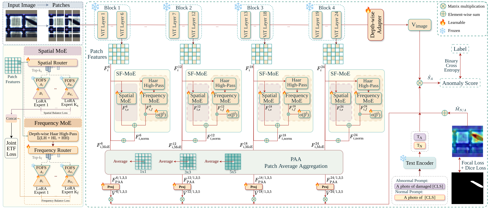

# sf-moeclip

## Abstract
Zero-shot anomaly detection aims to identify and localize defects in unseen categories without access to anomalous training samples. Although contrastive language--image pretraining (CLIP)-based methods provide strong vision-language generalization, their patch-level representations are often insufficient for expert inspection domains, where anomalies appear as subtle texture changes, structural discontinuities, or modality-specific defect patterns. This limitation is particularly evident in photovoltaic inspection, where defects in RGB, ultraviolet, and electroluminescence images frequently manifest as fine high-frequency irregularities on repetitive grid-like structures. To address this challenge, we propose SF-MoECLIP, a spatial--frequency Mixture-of-Experts framework for zero-shot anomaly detection. SF-MoECLIP extends MoECLIP by introducing a dual-stream expert design: a spatial stream adapts standard patch-token features, while a parallel frequency stream operates on parameter-free Haar high-pass representations of the patch grid. The two streams are independently routed and fused through a learnable layer-wise mixing mechanism, enabling complementary specialization while preserving the spatial-only baseline behavior at initialization. Joint expert regularization further encourages diversity across spatial and frequency experts. We evaluate SF-MoECLIP on a broad set of industrial, medical, and photovoltaic anomaly detection benchmarks, including newly collected RGB and UV photovoltaic datasets with pixel-level annotations. Experimental results show that SF-MoECLIP improves both image-level detection and pixel-level localization over strong CLIP-based baselines. These results demonstrate the effectiveness of explicit spatial--frequency expert specialization for robust zero-shot anomaly detection across heterogeneous visual domains. The code and trained models will be released publicly upon acceptance.